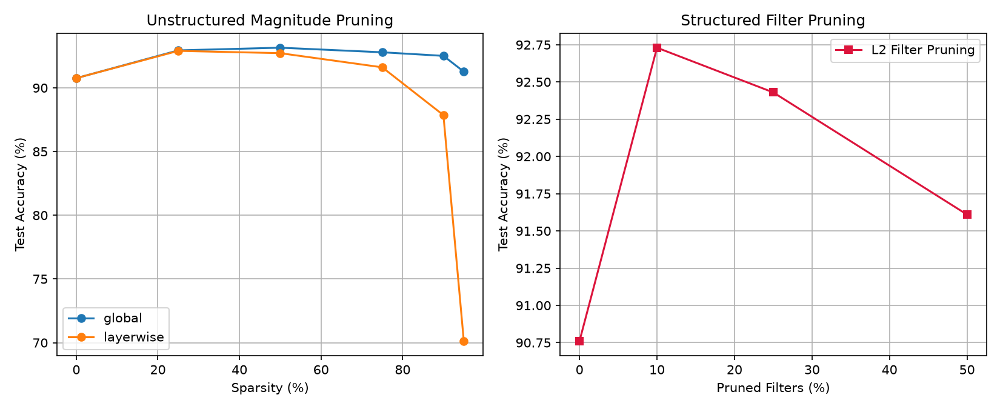

# Lab 7: Model Compression — Pruning and Knowledge Distillation

## 1. Oversized Baseline CNN

An oversized convolutional neural network (OversizedCNN) was trained on Fashion-MNIST for 6 epochs to serve as the teacher and unpruned baseline:

- Parameters: 768,010
- On-disk Size (FP32): 2.94 MB
- Compute: 60.23 MFLOPs
- Single-sample CPU Latency: 1.11 ms (initial run) / ~0.50 ms (warmed-up cache)
- Test Accuracy: 91.34%

---

## 2. Magnitude Pruning Results

### 2.1 Unstructured Pruning (Global vs. Layer-wise)

Weights were ranked by absolute value ($|w|$), masked at target sparsity levels [0.0, 0.25, 0.50, 0.75, 0.90, 0.95], and fine-tuned for 3 epochs with fixed binary masks:

| Sparsity | Global Accuracy | Global Latency (ms) | Layer-wise Accuracy | Layer-wise Latency (ms) |
| :------- | :-------------: | :-----------------: | :-----------------: | :---------------------: |
| 0.00     |     91.34%      |        1.12         |       91.34%        |          1.10           |
| 0.25     |     92.89%      |        1.26         |          —          |            —            |
| 0.75     |     92.79%      |        0.49         |       91.61%        |          0.53           |
| 0.90     |     92.51%      |        0.48         |       87.86%        |          0.48           |
| 0.95     |     91.27%      |        0.49         |       70.12%        |          0.53           |

_Observation:_ Global pruning significantly outperforms layer-wise pruning at high sparsity (92.51% vs. 87.86% at 90% sparsity, and 91.27% vs. 70.12% at 95% sparsity), because it preserves capacity in bottleneck convolutional layers while aggressively pruning redundant dense connections.

### 2.2 Structured Filter Pruning ($L_2$-Norm)

Whole convolutional filters with the lowest $L_2$-norm were physically removed and channels were rebuilt, followed by 3 epochs of fine-tuning:

| Pruned Filters | Parameters | FLOPs (M) | CPU Latency (ms) | Test Accuracy |
| :------------: | :--------: | :-------: | :--------------: | :-----------: |
| 0% (Baseline)  |  768,010   |   60.23   |    0.50–1.11     |    91.34%     |
|      10%       |  657,325   |   49.05   |       0.44       |    92.73%     |
|      25%       |  507,946   |   34.34   |       0.41       |    92.43%     |
|      50%       |  293,962   |   15.67   |       0.27       |    91.61%     |

---

## 3. Honest Latency & Storage Analysis (Dense vs. Sparse)

- On-disk Storage (90% Global Sparsity): Saving the masked model in standard dense format takes 2.94 MB, whereas converting tensors to torch.sparse_coo reduces disk footprint to 2.23 MB (~24% reduction). Even with 90% zeros, COO format stores explicit 64-bit coordinate indices alongside non-zero values, limiting compression gains.
- Why Unstructured Sparsity Does Not Speed Up Dense CPU Kernels: Across 75%, 90%, and 95% unstructured sparsity, CPU latency remains flat at 0.48–0.53 ms. Standard CPU BLAS/GEMM routines execute dense matrix multiplications regardless of zero entries. Attempting to use sparse matrix kernels at <99% sparsity introduces index-decoding overhead, irregular memory access patterns, and CPU cache misses, making it slower than dense SIMD execution. Conversely, 50% structured filter pruning reduces tensor dimensions directly, cutting compute by ~74% (to 15.67 MFLOPs) and lowering latency to 0.27 ms.

---

## 4. Knowledge Distillation (Teacher vs. Student)

A compact StudentCNN (~98.5k parameters, ~7.8× smaller than the teacher) was trained for 6 epochs both independently (Cross-Entropy only) and via Knowledge Distillation ($T = 4.0$, $\alpha = 0.5$):

| Model                                 | Parameters | Size (MB) | FLOPs (M) | CPU Latency (ms) | Test Accuracy |
| :------------------------------------ | :--------: | :-------: | :-------: | :--------------: | :-----------: |
| Teacher (Oversized)                   |  768,010   |   2.94    |   60.23   |    0.50–1.11     |    91.34%     |
| Plain Student (CE only)               |   98,458   |   0.38    |   7.49    |       0.24       |    89.33%     |
| Distilled Student ($T=4, \alpha=0.5$) |   98,458   |   0.38    |   7.49    |       0.23       |    90.32%     |

Soft logits from the teacher transferred dark knowledge (inter-class similarity structure), improving student accuracy by +0.99 percentage points (from 89.33% to 90.32%) with zero additional inference cost.

---

## 5. Summary Across Chapter 9 Efficiency Pillars

| Model Variant             | Data Pillar                        | Model Pillar (Params / Disk)    | Compute Pillar (FLOPs / Latency) | Energy Pillar (Estimated Relative)         | Accuracy |
| :------------------------ | :--------------------------------- | :------------------------------ | :------------------------------- | :----------------------------------------- | :------: |
| Oversized Baseline        | Full Fashion-MNIST (60k, FP32)     | 768,010 params / 2.94 MB        | 60.23 MFLOPs / 0.50–1.11 ms      | High (1.00× baseline DRAM + ALU energy)    |  91.34%  |
| Unstructured Pruned (90%) | Full Fashion-MNIST + fixed mask    | 76,801 non-zero / 2.23 MB (COO) | 60.23 MFLOPs (dense) / 0.48 ms   | High (~0.95× — dense MACs still executed)  |  92.51%  |
| Structured Pruned (50%)   | Full Fashion-MNIST (fine-tuned)    | 293,962 params / ~1.12 MB       | 15.67 MFLOPs / 0.27 ms           | Low (~0.26× compute & memory traffic)      |  91.61%  |
| Plain Student (~100k)     | Hard ground-truth labels only      | 98,458 params / 0.38 MB         | 7.49 MFLOPs / 0.24 ms            | Very Low (~0.13× — fits in L2/L3 cache)    |  89.33%  |
| Distilled Student ($T=4$) | Ground-truth + Teacher soft logits | 98,458 params / 0.38 MB         | 7.49 MFLOPs / 0.23 ms            | Very Low (~0.13× — highest accuracy/Joule) |  90.32%  |

### Conclusion

Unstructured magnitude pruning achieves the highest accuracy (92.51% at 90% sparsity) due to implicit regularization, but provides negligible CPU speedup because dense kernels still process zeroed weights. When real hardware latency and energy efficiency are required, structured filter pruning (cutting latency to 0.27 ms while maintaining 91.61% accuracy) and knowledge distillation (achieving 90.32% accuracy at 0.38 MB and 0.23 ms) provide the best Pareto trade-off for edge deployment.
